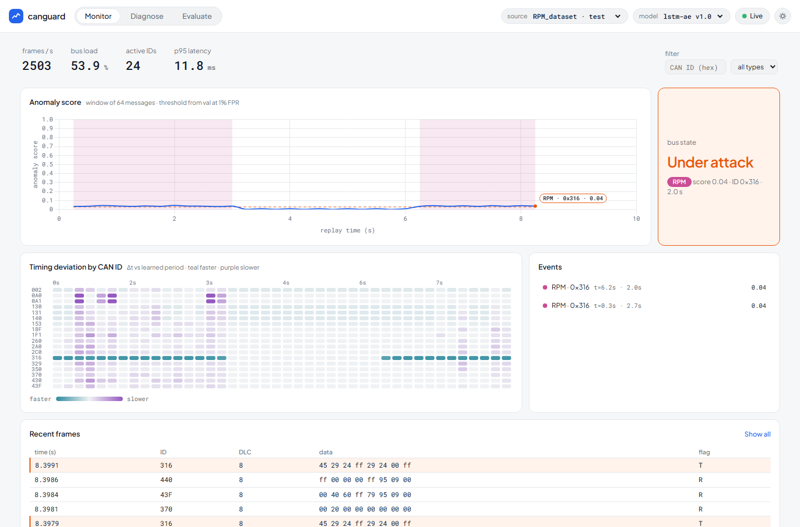
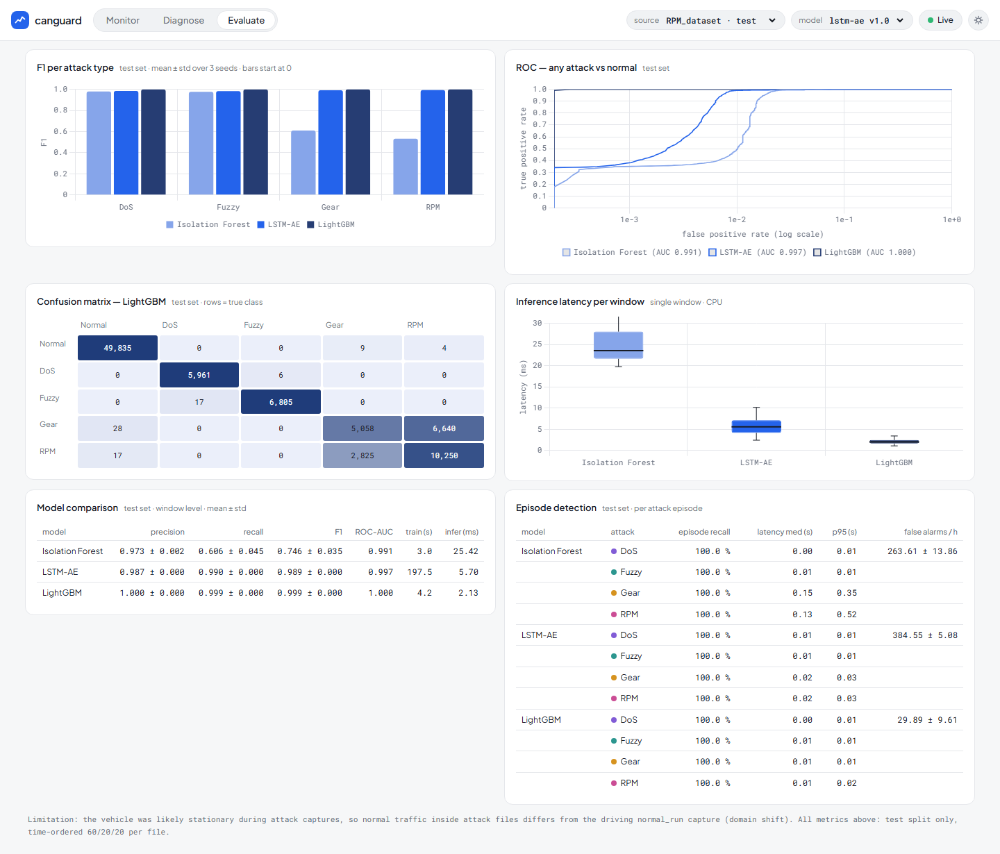
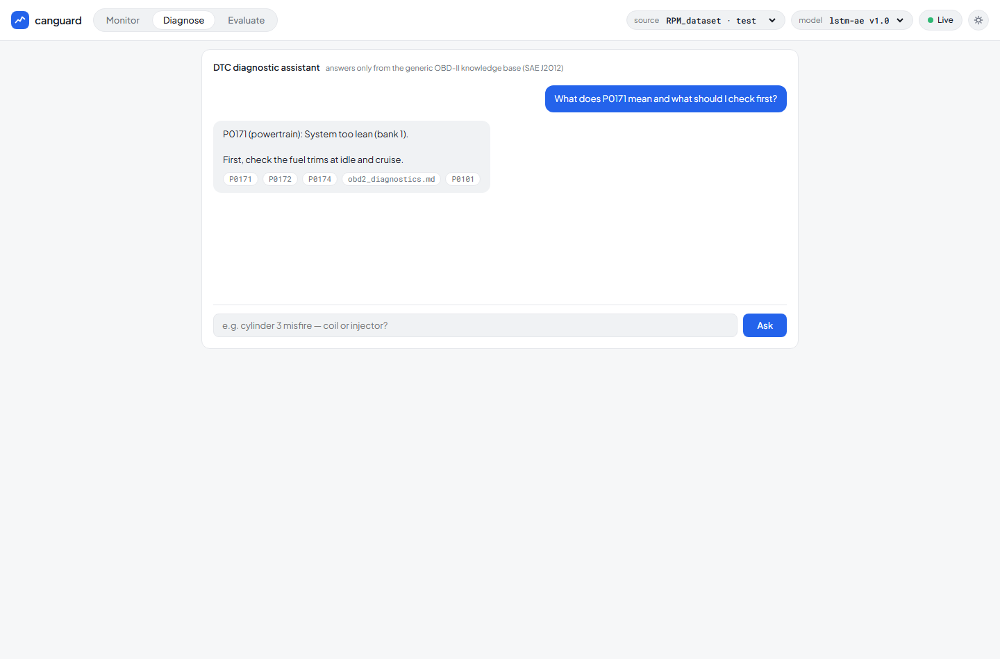
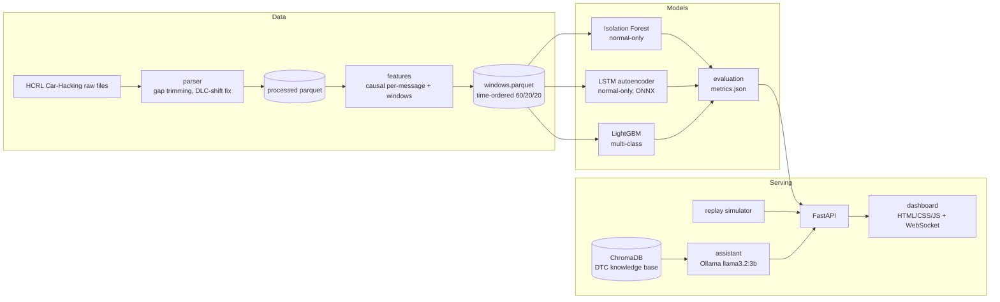

# canguard

**AI-powered CAN bus intrusion detection with a live dashboard and a local
RAG diagnostic assistant — CPU-only, fully reproducible.**

Modern vehicles run dozens of ECUs on a CAN bus that has no sender
authentication: any node that reaches the bus can inject frames that every
other node will trust. As vehicles become software-defined and externally
connected (telematics, OTA, V2X), that 1986 design decision becomes an
attack surface. **canguard** detects frame-injection attacks (DoS flooding,
fuzzing, spoofing) on real captured CAN traffic, explains OBD-II diagnostic
trouble codes with a locally-hosted LLM grounded in a curated knowledge
base, and visualizes both on a custom real-time dashboard.

Everything runs on a laptop CPU: training finishes in minutes, inference is
2–6 ms per window, and the LLM is a local `llama3.2:3b` via Ollama.

## Screenshots

| Monitor (live replay) | Evaluate | Diagnose |
|---|---|---|
|  |  |  |

*(screenshots: `reports/screenshots/` — see also the dark theme
`monitor_dark.png`)*

## Architecture



## Dataset

**HCRL Car-Hacking Dataset** — Seo, E., Song, H. M., & Kim, H. K. (2018),
*GIDS: GAN based Intrusion Detection System for In-Vehicle Network*, PST
2018. Available at
<https://ocslab.hksecurity.net/Datasets/car-hacking-dataset>. Place the
files in `data/raw/car_hacking/`:

```
DoS_dataset.csv  Fuzzy_dataset.csv  gear_dataset.csv  RPM_dataset.csv  normal_run_data.txt
```

~14 M frames after cleaning: DoS floods ID `0x000` (highest arbitration
priority), Fuzzy sprays random IDs/payloads, gear/RPM spoof one legitimate
ID each (`0x43F`, `0x316`). Injected frames are labeled `T`, normal `R`.

### Dataset issues handled by the parser

- **Terminal recording gaps** (documented by Verma et al. in the ROAD
  dataset paper): each attack file ends with a recording discontinuity
  followed by attack-free traffic (a 22.4 s break at ~2328 s in DoS; gaps
  of 2539/5588/7745 s in Fuzzy/gear/RPM). Since the second-largest gap in
  any file is 0.71 s, the parser trims at the first gap > 10 s; the
  trimmed captures span 2328/2466/1949/1952 s — matching Verma et al.'s
  figures.
- **DLC < 8 rows** carry the R/T flag in an earlier column; the parser
  resolves the flag position per row and zero-fills short payloads.
- `normal_run_data.txt` uses a different text format (parsed separately;
  1 malformed line dropped).

## Methodology

- **Features** (all causal — computable on a live stream):
  per-message Δt since the previous frame, Δt within the same CAN ID, and
  the relative deviation from the ID's expected period; per 64-message
  window (stride 32): ID entropy, unique-ID count, unknown-ID ratio,
  inter-arrival mean/std, period-deviation aggregates.
- **Leakage control**: expected periods and the known-ID set are learned
  only on attack-free frames from the *train* portions (pooled across all
  five captures so the models learn "normal vs attack", not "driving vs
  stationary"); splits are time-ordered 60/20/20 per file with no
  shuffling; windows never cross a split or file boundary.
- **Training**: the anomaly detectors (Isolation Forest, LSTM autoencoder)
  see attack-free windows only. The supervised LightGBM multi-class model
  is the comparison ceiling.
- **Thresholds**: chosen on the validation split at 1 % false-positive
  rate on attack-free windows (the F1-optimal threshold is reported for
  comparison). Scores are normalized to [0, 1] with validation
  percentiles.
- **Evaluation**: test split only; mean ± std over seeds 42/43/44.

## Results

Window-level, test split (window = attack if ≥ 1 injected frame):

| model | precision | recall | F1 | ROC-AUC | train time | infer / window (CPU) |
|---|---|---|---|---|---|---|
| Isolation Forest (unsup.) | 0.973 ± 0.002 | 0.606 ± 0.045 | 0.746 ± 0.035 | 0.991 | 3 s | 25.4 ms |
| LSTM autoencoder (unsup.) | 0.987 ± 0.000 | 0.990 ± 0.000 | **0.989 ± 0.000** | 0.997 | 198 s | 5.7 ms |
| LightGBM (supervised) | 1.000 ± 0.000 | 0.999 ± 0.000 | **0.999 ± 0.000** | 1.000 | 4 s | 2.1 ms |

Episode level (51–68 attack bursts per type in test): **every model detects
100 % of attack episodes**, with median detection latency 4–148 ms and p95
≤ 524 ms. False alarms per hour of attack-free traffic: LightGBM 30/h,
Isolation Forest 264/h, LSTM-AE 385/h — a 1 % *window* FPR is a lax
operating point at ~60 windows/s (see Limitations).

Selected findings (full numbers in `reports/metrics.json`,
reasoning in `reports/feature_notes.md` and `PROGRESS.md`):

- **Isolation Forest's weakness is threshold placement, not ranking**: AUC
  0.991 but recall 0.61 at the 1 % FPR threshold — it ranks DoS/fuzzy far
  above spoofing anomalies, so a fixed threshold misses ~half of the
  spoofed windows (F1 0.978 at the F1-optimal threshold).
- **Feature ablation**: ID-distribution features alone nearly solve
  DoS/fuzzy (unknown-ID ratio, entropy); the timing features are what make
  gear/RPM spoofing detectable. For the Isolation Forest, the unbounded
  period-deviation features actually *hurt* (they dominate its splits);
  LightGBM is insensitive to the feature mix.
- **Leave-one-attack-type-out**: LightGBM still flags ~100 % of windows of
  an attack type it never saw in training (other attacks teach it "not
  normal") — but it cannot *name* it, which is the practical argument for
  keeping anomaly detectors alongside a classifier.
- **Gear vs RPM confusion**: the supervised per-class F1 collapses to
  0.52/0.68 for gear/RPM (both spoof a single legitimate ID, and the
  window features are aggregates with no "which ID" information), while
  binary detection stays at 0.999. Visible honestly in the dashboard's
  confusion matrix.
- **Embedded candidate**: a 428-parameter dense autoencoder on the same
  window features reaches test ROC-AUC 0.9996 (PC-measured) and exports to
  a 2.8 KB ONNX for STM32Cube.AI — see `embedded/README.md`.

### RAG assistant (local, no paid APIs)

Knowledge base: 55 generic OBD-II DTCs (SAE J2012 / ISO 15031-6 generic
definitions) + CAN/OBD-II reference notes; embeddings
`all-MiniLM-L6-v2`; ChromaDB; generation `llama3.2:3b` via Ollama,
answering **only** from retrieved context with similarity-gated refusal.
Hybrid retrieval pins exact DTC codes mentioned in the question.

Retrieval hit-rate over 17 questions: **0.59 @1, 0.94 @3, 1.00 @5**;
out-of-scope refusal 1/1; the 3b model cites the expected code in 4/6
generation checks (misses answer from sibling codes, e.g. P0430 for a
P0420 question).

## How to run

```powershell
# 1. environment (Python 3.10+)
python -m venv .venv
.venv\Scripts\activate
pip install torch --index-url https://download.pytorch.org/whl/cpu
pip install -r requirements.txt

# 2. data pipeline (dataset files in data/raw/car_hacking/ first)
python -m src.data.parser
python -m src.data.features

# 3. models + evaluation (CPU, ~15 min total)
python -m src.models.train
python -m src.models.evaluate

# 4. knowledge base (Ollama running with llama3.2:3b for generation)
python -m src.rag.build_kb
python -m src.rag.evaluate_rag

# 5. dashboard
.\run.ps1          # -> http://127.0.0.1:8000
```

`run.ps1` runs any missing pipeline step automatically. A Dockerfile is
provided for the API + dashboard (mount `data/`, `models/`, `reports/`,
`knowledge_base/`; point `OLLAMA_HOST` at a reachable Ollama).

Tests: `python -m pytest tests` (22 tests; API/KB-dependent tests
self-skip on a fresh clone).

Exploratory analysis: `notebooks/01_eda.ipynb` (executed; figures in
`reports/figures/`).

## Limitations

- **Benchmark easiness**: the HCRL attacks are blatant at window level —
  near-ceiling supervised scores are a known property of this dataset (the
  criticism that motivated the ROAD dataset), not evidence of a
  state-of-the-art detector. The unsupervised results and the ablation /
  LOAO / episode analyses are the informative part.
- **Domain shift**: the vehicle was likely stationary during attack
  captures, so "normal" traffic inside attack files differs from the
  driving `normal_run_data.txt`. Mitigated by pooling both into training
  stats; stated in the dashboard footnote.
- **Operating point**: 1 % window-level FPR translates to hundreds of
  false alarm events per hour for the unsupervised models; a deployment
  would tune an event-level alarm budget instead.
- **Attack-type attribution** between the two spoofing attacks is weak by
  feature design (no per-ID features), although detection is unaffected.
- Single vehicle (2017 Hyundai Sonata-class captures), single bus, message
  injection only — no suspension/masquerade attacks (ROAD covers those).

## Future work

- ROAD dataset as a generalization benchmark (`data/raw/road/` hook exists
  in the config).
- Per-ID features / sequence models for spoofing attribution.
- Event-level alarm budgeting and threshold tuning.
- UDS (ISO 14229) request/response awareness and real OBD-II logging.
- On-target STM32 measurements (see `embedded/README.md`).

## References

- Seo, Song & Kim (2018), *GIDS: GAN based Intrusion Detection System for
  In-Vehicle Network*, PST 2018 — the Car-Hacking Dataset.
- Verma et al. (2022), *ROAD: The Real ORNL Automotive Dynamometer CAN
  Intrusion Dataset*, arXiv:2012.14600 — documents the recording gaps and
  benchmark criticism.
- SAE J2012 / ISO 15031-6 — generic DTC definitions.

## License

MIT — see [LICENSE](LICENSE).
